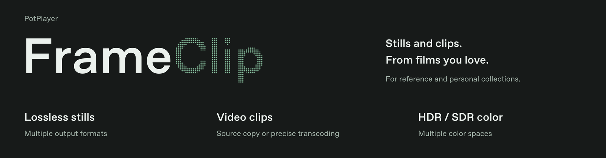

<picture>
  <source media="(prefers-color-scheme: dark)" srcset="assets/readme/banner-dark.png">
  <source media="(prefers-color-scheme: light)" srcset="assets/readme/banner-light.png">
  
</picture>

# PotPlayer FrameClip

**Keep the shots you love. Build a collection for inspiration and creative work.**

FrameClip captures film and television stills and clips from PotPlayer's context menu. Save lossless images and source-copy clips for a personal collection, or gather references for color grading, editing and shot studies. Captures are automatically filed by video title.

[Download 0.4.2 stable](https://github.com/XWYT/PotPlayerFrameClip/releases/tag/v0.4.2) · [中文](README.md) · [User guide](docs/guide.en.md)

## Features

- **Lossless stills and source-copy clips:** read the media file directly to save PNG/TIFF images or copy clips without re-encoding. Precise transcoded cuts are also available for editing.
- **Automatic folders by title:** recognize titles and episode markers in filenames, with help from folders, media titles and remembered name mappings. Keep images and clips from the same work together; uncertain titles go into unclassified folders.
- **Formats, codecs and color spaces:** support multiple HDR/SDR color spaces, 16-bit images and ProRes/DNxHR editing codecs. HDR stills can include an SDR viewing copy.
- **Capture while exporting:** run concurrent clip exports and take screenshots during them. Track progress, cancel, retry and open results. GPU-preferred decoding is enabled by default, with configurable resource use.

Chinese/English UI, light/dark themes and adjustable multi-monitor notifications. Supports 32/64-bit and portable PotPlayer. Media stays on your computer; no telemetry.

## Install

Requires Windows 10/11, PotPlayer, .NET Framework 4.6.2 or newer, and a matching `ffmpeg.exe` / `ffprobe.exe` pair.

1. Download `PotPlayerFrameClip-v0.4.2-Setup.exe` and its `.sha256` file from [Releases](https://github.com/XWYT/PotPlayerFrameClip/releases/tag/v0.4.2).
2. Finish current jobs, close PotPlayer and FrameClip, then run the installer. Select your player folder if you use a portable installation.
3. Choose an existing FFmpeg installation, or configure it later under Settings > Output.
4. Reopen PotPlayer, play a local video and select **Reference Frame & Clip Capture** from its context menu.

The public installer does not include FFmpeg. If it is missing, install it with:

```powershell
winget install --id Gyan.FFmpeg --exact --source winget --accept-package-agreements --accept-source-agreements
```

FrameClip can be installed before FFmpeg is configured; captures and exports require it. The installer is not commercially code-signed. Use the project Releases page and verify the checksum. See the [user guide](docs/guide.en.md#install-and-upgrade) for custom paths, upgrades and uninstalling.

## Use

| Goal | Action |
| --- | --- |
| Save the current shot | Choose Capture current frame at the desired playback position |
| Keep an original clip | Set in/out points, then Export source clip |
| Prepare a clip for editing | Set in/out points, then Export precise clip |
| View progress or retry | Open the task center from the FrameClip tray icon |
| Find captured material | Open the current work's image or video folder from the menu |
| Change formats, folders or notification placement | Open Settings |

Default output is under your Windows Videos folder:

```text
FrameClip/
└── Work title/
    ├── 图片/
    └── 视频/
```

`图片` contains images; `视频` contains clips. You can change the root folder. Classification uses existing names and metadata; it does not analyze the picture or look up titles online.

## Formats and quality

| Output | Support |
| --- | --- |
| Lossless images | 16-bit RGB PNG/TIFF; available color tags in PNG and color information in filenames |
| Source-copy clips | MKV, retaining the video codec and compatible audio, subtitles and metadata; cuts depend on keyframes |
| Precise clips | MOV with ProRes 422 HQ / 4444 / 4444 XQ or DNxHR HQX / 444, plus 24-bit PCM audio |
| HDR / SDR | Multiple color spaces; HDR originals retain the source transfer function, with an optional tone-mapped Rec.709 SDR copy |

Lossless refers to image compression and copying encoded streams without re-encoding. Decoding and RGB conversion still have precision limits; ProRes/DNxHR exports are transcodes. Assign the correct input color space when using HDR originals in color-managed software. See the [user guide](docs/guide.en.md#formats-and-color) for Dolby Vision limits, import guidance and GPU compatibility.

## More

- [User guide: installation, settings, color and troubleshooting](docs/guide.en.md)
- [GPU processing and compatibility](docs/gpu-processing.md): real-media checks cover the NVIDIA development host; Intel/AMD real-device coverage remains limited.
- [Release notes](docs/releases/v0.4.2.md) · [Changelog](CHANGELOG.md)
- [Build from source](docs/guide.en.md#build-from-source)

FrameClip is an independent external extension, not an official PotPlayer SDK plugin. It is not endorsed by Kakao or the PotPlayer developers. Source is licensed under [MIT](LICENSE); see [third-party notices](THIRD_PARTY_NOTICES.md).
