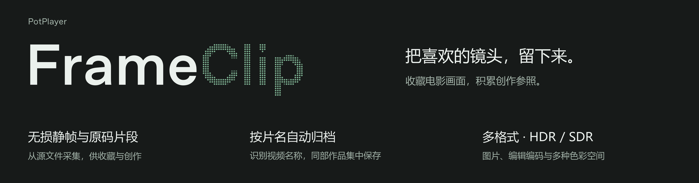

<picture>
  <source media="(prefers-color-scheme: dark)" srcset="assets/readme/banner-zh-dark.png">
  <source media="(prefers-color-scheme: light)" srcset="assets/readme/banner-zh-light.png">
  
</picture>

# PotPlayer FrameClip

**采集影视静帧与片段，用作创作参照或个人收藏。**

为调色收集色彩、光线和影调参照，为创作整理镜头与片段，或保存电影、剧集中喜爱的画面。通过 PotPlayer 右键菜单即可操作。FrameClip 直接读取源文件，不截取桌面画面，也不经过显示器的色调映射。

支持无损静帧、多格式片段导出和多种 HDR/SDR 色彩空间。片段既可保留原码，也可精确转码，供后期编辑使用。

**当前版本：0.4.1 正式版。** [下载与版本说明](https://github.com/XWYT/PotPlayerFrameClip/releases/tag/v0.4.1) · [English](README.en.md)

安装后，PotPlayer 右键菜单中会出现 **参照帧与片段截取**。

## 主要功能

- **无损静帧**：直接从源文件截取画面，支持多种图片格式，并记录色彩信息，便于后续使用和整理。
- **HDR 与 SDR 参照**：支持多种 HDR/SDR 色彩空间。保存 HDR 原图时，还可生成便于查看的 SDR 副本。
- **片段导出**：可保留原码，也可按精确切点转码为适合后期编辑的格式。
- **后台处理**：多个任务可同时导出，导出期间也能截图。进度随时可查，任务支持取消、重试和打开结果文件。GPU 可用时优先使用硬件解码，不降低图片精度，也不擅自更换所选编码格式。
- **按作品归档**：自动建立 `作品名\图片` 与 `作品名\视频` 文件夹，识别剧集季数、集数及常见文件命名。无法确认片名时放入“待归类”目录，避免误归到其他作品。
- **原生操作**：直接通过 PotPlayer 右键菜单截取。支持中英双语、明暗主题和多显示器提醒，兼容 32/64 位及便携版播放器。升级保留自定义菜单，卸载时恢复原有菜单。

输出位置、图片格式、转码预设、性能策略和提醒位置均可在设置中调整。任务使用提交时确定的源文件、截取范围和设置，不受之后的播放操作或设置调整影响。

0.4.1 正式发布新版界面、任务进度、并行导出和 GPU 优先处理，并修复外观刷新时的托盘菜单生命周期问题，详见[版本说明](docs/releases/v0.4.1.md)。Intel/AMD 实机、不同皮肤、物理混合 DPI 和长时间使用仍需扩大验证覆盖。公开的轻量安装包不含 FFmpeg。

## GPU 处理

在“设置 > 性能 > 视频与截图处理”中，可选择“GPU 优先”（默认）或“仅 CPU”。硬件解码使用已有的 FFmpeg 和显卡驱动，不额外打包 CUDA Toolkit。

程序根据设备和源格式选择 CUDA、D3D11VA、Intel QSV，或在单显卡环境下回退到 DXVA2；多显卡环境按设备分别分配任务和资源预算。任务中心会显示实际使用的后端，不支持硬件解码或资源不足时改用 CPU。短任务不一定比 CPU 更快。

GPU 优先不会改变所选的 ProRes/DNxHR 编码、16-bit PNG/TIFF 输出或原有色彩处理流程。原码复制不需要解码。Intel/AMD 已通过调度策略测试，但尚未完成实机验证，不能视为适配了所有型号。适用范围、开源方案评估和本机实测见 [GPU 处理说明](docs/gpu-processing.md)。

## 精度说明

静帧提供 16-bit RGB PNG/TIFF；原码片段使用 MKV，精确片段使用 MOV，支持 ProRes 422 HQ、4444、4444 XQ、DNxHR HQX、444 与 24-bit PCM 音频。PNG 写入可用色彩标签，文件名记录色彩解释信息；原码复制保留可复制的音视频、字幕和元数据。

这里的“无损”指 PNG/TIFF 的图片压缩和原码片段不重新编码。视频解码、YCbCr 到 RGB 转换和源文件本身仍有精度边界；16-bit 输出不会恢复源中已经丢失的细节。ProRes/DNxHR 属于重新编码，不能称为源流无损复制。

FrameClip 的 HDR 原图转换仅完成 YCbCr 到 RGB 的矩阵与码值范围变换，不应用显示 LUT，也不改变 PQ/HLG 传递函数。HDR 图片在普通图片查看器中可能显得暗淡或异常，这是查看器按错误传递函数显示造成的结果。导入后期软件后，应依据文件名和源元数据指定正确的输入色彩空间。

设置中的“截取 HDR 图片时同时生成 Rec.709 SDR 副本”只对 PQ 和 HLG 来源生效。副本先转换到线性浮点光，再使用 FFmpeg Mobius 色调映射输出全范围 16-bit Rec.709 RGB，文件名带有 `Rec709-SDR-TONEMAPPED`。该文件用于普通显示器、图片查看器和 SDR 参照，不替代原 HDR 图，也不是可逆的母版转换。

Dolby Vision Profile 5 等缺少可靠 HDR10/HLG 兼容基础层的来源会被拒绝生成参照帧，防止输出偏色图片。Profile 7/8 等兼容来源输出可解码基础层；动态元数据不会烘焙进 PNG、TIFF、ProRes 或 DNxHR。需要保留完整源流时使用“导出原码片段”。

## 系统要求

| 项目 | 要求 |
| --- | --- |
| 操作系统 | Windows 10 或 Windows 11，x64/x86 |
| 播放器 | PotPlayer 32 位或 64 位；标准安装、便携版均可 |
| 运行环境 | .NET Framework 4.6.2 或更高版本 |
| 媒体工具 | `ffmpeg.exe` 与同目录下的 `ffprobe.exe`；HDR 转 Rec.709 副本需要 `zscale` 和 `tonemap` 滤镜 |

FrameClip 不捆绑 PotPlayer 或 .NET Framework。公开轻量包不含 FFmpeg；本地离线完整版可选安装专用 FFmpeg。程序运行期间不访问网络。

### 安装器与离线 FFmpeg

- 安装、升级、卸载使用与主程序一致的原生界面；“开机自启动”表示 Windows 用户登录后自动运行 FrameClip。
- 轻量包 Setup.exe：使用已有 FFmpeg，或稍后在设置中配置。未配置时仍可安装，但截图和导出暂不可用。
- 离线完整版 Setup-Full.exe：增加“未安装，配置内置 FFmpeg”。无需额外联网，安装在程序目录 tools/ffmpeg/<版本>/，不改 PATH、不覆盖外部版本。
- 已有版本须包含同一目录下的 ffmpeg.exe 与 ffprobe.exe。升级保留已有配置；选择“稍后配置”不会清空之前的路径。
- 安全覆盖升级不是运行中热更新：先完成任务并关闭播放器，安装器备份后替换；配置失败回退。卸载默认保留设置、记录和导出素材，删除设置须主动勾选。
- 内置媒体工具是 Win64 构建；32 位 PotPlayer 可在 64 位 Windows 使用。32 位 Windows 应选兼容的外部 FFmpeg。
- Full 包目前为本地开发候选；公开发布前还需完成对应源码与第三方许可材料归档，不表示 GitHub 已提供此包。

构建离线候选：先运行 scripts/prepare-ffmpeg.ps1 -Download，再运行 scripts/build.ps1 -Version 0.4.1 -BundleFFmpeg。下载仅发生于构建时，版本与 SHA256 固定在 installer/ffmpeg-manifest.json。

静默安装参数：/FFMPEGMODE=existing|bundled|later；已有版本配合 /FFMPEGPATH="完整路径"。轻量包请求 bundled 会在替换前失败。完整包未检测到已有 FFmpeg 时默认内置版本。

### 安装 FFmpeg

推荐使用 WinGet 安装当前稳定版：

```powershell
winget install --id Gyan.FFmpeg --exact --source winget --accept-package-agreements --accept-source-agreements
```

关闭并重新打开 PowerShell 后检查：

```powershell
ffmpeg -version
ffprobe -version
```

也可从 [FFmpeg 官方下载页](https://ffmpeg.org/download.html)进入其列出的 Windows 构建站点。手动解压时，请在安装器中选择 `bin\ffmpeg.exe`；`ffprobe.exe` 应位于同一目录。

### 安装 .NET Framework

Windows 10/11 通常已包含兼容的 .NET Framework 4.x。程序启动时若提示缺少运行环境，可安装 [Microsoft .NET Framework 4.8.1 Runtime](https://dotnet.microsoft.com/download/dotnet-framework/net481)。用于构建源码的完整开发包也可通过 WinGet 安装：

```powershell
winget install --id Microsoft.DotNet.Framework.DeveloperPack_4 --exact --source winget --accept-package-agreements --accept-source-agreements
```

## 安装

### 方式一：交给 AI Agent 安装

直接复制下面整段提示词，发送给能够访问网络、文件和 PowerShell 的 AI Agent：

```text
请在这台 Windows 电脑上安装 PotPlayer FrameClip。

项目地址：https://github.com/XWYT/PotPlayerFrameClip

要求：
1. 从上述项目 GitHub Releases 下载本 README 所述的 0.4.1 正式版安装程序 PotPlayerFrameClip-v0.4.1-Setup.exe。不要下载源码压缩包，也不要从第三方网站获取文件。
2. 确认下载链接属于上述 GitHub 仓库；如果发布页提供 SHA-256，请在安装前核对。安装包目前没有商业代码签名，不要关闭 Windows 安全功能，也不要在来源无法确认时绕过安全警告。
3. 检查 PotPlayer、ffmpeg.exe、ffprobe.exe 和 .NET Framework 4.6.2 或更高版本。缺少 FFmpeg 时，优先使用 WinGet 安装 Gyan.FFmpeg；不要重新安装或修改已经正常工作的依赖。
4. 自动识别 PotPlayer 安装目录和 FFmpeg 路径。标准安装、32 位、64 位或便携版无法自动识别时，再根据本机实际路径向安装程序传入 /POTPLAYERDIR 和 /FFMPEGPATH。
5. 使用安装程序完成当前用户安装，不重启 Windows。如果 PotPlayer 正在运行且会影响安装，请先让我关闭，不要擅自结束播放器或其他无关进程。
6. 安装后确认 %LOCALAPPDATA%\PotPlayerFrameClip\PotPlayerFrameClip.exe 存在，FrameClip 常驻程序能够启动，并检查 PotPlayer 目录下是否生成 Menus\FrameClipMenu.xml。
7. 告诉我最终安装的版本、程序目录、识别到的 PotPlayer 与 FFmpeg 路径、验证结果，以及是否需要我重新打开 PotPlayer。遇到失败时保留错误信息并说明具体处理办法，不要反复盲目重试。
```

Agent 仍可能需要你确认 Windows SmartScreen 提示或 PotPlayer 便携版目录。安装结束后，重新打开一次 PotPlayer，右键菜单中应出现 **参照帧与片段截取**。

### 方式二：下载安装包

1. 从 GitHub Releases 下载一个文件：`PotPlayerFrameClip-v<版本>-Setup.exe`，不要下载 `Source code` 压缩包。
2. 关闭 PotPlayer，再双击安装程序。原生菜单桥接会在播放器进程生命周期内保持加载，不能在播放期间安全替换；不需要重启 Windows。
3. Windows SmartScreen 在未签名开源程序上可能显示警告，请先核对文件名与 GitHub 仓库；确认来源后选择“更多信息”继续。
4. 安装器会自动查找 PotPlayer 和 FFmpeg。便携版或自定义目录未被识别时，在向导中手动选择。
5. 完成安装后重新打开 PotPlayer，播放本地媒体并右键选择 **参照帧与片段截取**。

程序、设置、日志和作品别名位于：

```text
%LOCALAPPDATA%\PotPlayerFrameClip
```

默认输出位于：

```text
%USERPROFILE%\Videos\FrameClip\作品名\图片
%USERPROFILE%\Videos\FrameClip\作品名\视频
```

输出根目录可以在 FrameClip 设置中修改。程序不会在参照素材目录中写入使用说明或安装文件。

### 静默安装与自定义路径

已经下载安装包时，可以在安装包所在目录运行以下 PowerShell 命令：

```powershell
$setup=Get-ChildItem -LiteralPath . -Filter 'PotPlayerFrameClip-v*-Setup.exe' | Sort-Object LastWriteTime -Descending | Select-Object -First 1; if(-not $setup){throw '当前目录没有 FrameClip 安装包'}; $p=Start-Process -FilePath $setup.FullName -ArgumentList '/VERYSILENT','/NORESTART','/LANG=chinesesimplified' -PassThru; Wait-Process -Id $p.Id
```

便携版 PotPlayer 与自定义 FFmpeg：

```powershell
$p=Start-Process -FilePath '.\PotPlayerFrameClip-v0.4.1-Setup.exe' -ArgumentList '/VERYSILENT','/NORESTART','/LANG=chinesesimplified','/POTPLAYERDIR="D:\Apps\PotPlayer"','/FFMPEGPATH="D:\Tools\ffmpeg\bin\ffmpeg.exe"' -PassThru; Wait-Process -Id $p.Id
```

可选参数：

| 参数 | 作用 |
| --- | --- |
| `/POTPLAYERDIR="目录"` | 指定包含 PotPlayer 主程序的目录 |
| `/FFMPEGPATH="文件"` | 指定 `ffmpeg.exe` |
| `/NOSTARTUP=1` | 不随当前用户登录启动菜单桥接程序 |
| `/DIR="目录"` | 修改 FrameClip 程序安装目录 |
| `/VERYSILENT /NORESTART` | 无界面安装，不重启 Windows |

## 使用

| 菜单项 | 结果 |
| --- | --- |
| 截取当前帧 | 按当前播放时间从源文件解码一张 16-bit RGB 图片 |
| 设置入点 / 设置出点 | 记录当前媒体与时间，用于后续片段导出 |
| 导出原码片段 | 快速流复制，保留源编码和可复制的音频、字幕；切点受关键帧限制 |
| 导出精确片段 | 重新编码，切点更准确，输出 ProRes 或 DNxHR 与 PCM 音频 |
| 清除入点和出点 | 删除当前记录的范围 |
| 设置 | 修改输出位置、图片格式、片段编码、HDR 的 Rec.709 副本、菜单语言和 FFmpeg 路径 |
| 打开当前作品图片/视频文件夹 | 目录不存在时先创建，再由资源管理器打开 |

若输出进入 `待归类剧集 [xxxxxxxx]` 或 `待归类作品 [xxxxxxxx]`，说明源文件只提供了 `01.mkv`、`02.mkv` 等弱名称，媒体元数据与上级目录也没有可验证的作品名。此时程序会保持同一来源目录的素材集中，并避免与其他未知作品合并。

语言在设置中切换。保存后，FrameClip 自身菜单立即使用新语言；PotPlayer 已经载入的 XML 菜单需要关闭并重新打开 PotPlayer 才会刷新。菜单文件位于受保护目录时，Windows 可能弹出一次管理员确认。

## 导入后期软件

- `Rec709-*`：按文件名标出的传递函数解释；常见来源为 Rec.709/BT.1886 类显示链路。
- `Rec2100-PQ`：指定 Rec.2100 ST 2084/PQ 输入。
- `Rec2100-HLG`：指定 Rec.2100 HLG 输入。
- `Rec709-SDR-TONEMAPPED`：已转换为全范围 16-bit Rec.709 SDR，可作为普通 SDR 参照图导入。
- `DV-P*-Base-*`：仅含可解码基础层，未应用 Dolby Vision 动态映射。
- PNG 优先用于需要读取色彩标签的流程。
- TIFF 为 16-bit 无损 RGB，但不同软件对 TIFF 色彩标签的支持差异较大，建议按文件名手动指定输入色彩空间。

原码片段保留源流，适合保存 HDR/Dolby Vision 信息或后续自行处理。精确片段会重新编码，动态元数据、部分字幕和原压缩音频不进入输出。

## 问题排查

### 点击插件菜单却打开“关于 PotPlayer”

0.4.0 修复了桥接钩子存在、但目标播放器尚未完成初始化时误判就绪的问题。新版在播放器进程确认桥接已执行后才标记就绪，并限制重试频率。请先结束导出、正常退出 PotPlayer，再升级并重新打开播放器。不要在播放器运行时替换桥接 DLL。

如果仍然发生，请记录 PotPlayer 版本、位数、皮肤名和显示缩放比例，并附上用户数据目录中的 `bridge-debug.log`、`menu-debug.log` 和最新运行日志。日志可能包含本地路径，公开提交前请检查并遮盖个人信息。

### 右键菜单没有“参照帧与片段截取”

1. 关闭并重新打开 PotPlayer。
2. 确认 `%LOCALAPPDATA%\PotPlayerFrameClip\PotPlayerFrameClip.exe` 存在。
3. 便携版用户重新运行安装器，并在“PotPlayer 位置”中选择正确目录。
4. 检查 PotPlayer 目录下是否存在 `Menus\FrameClipMenu.xml`。

### 点击所有扩展按钮都变成播放或暂停

这是 `0.2.x` 和 `0.3.0` 的旧菜单架构造成的。旧版把扩展项临时绑定到 PotPlayer 的播放/暂停命令，再依赖鼠标钩子覆盖；任何识别失败都会执行播放/暂停。`0.3.1` 已移除该危险绑定，`0.3.2` 进一步移除了菜单首行和尺寸推断。请升级安装并重新打开 PotPlayer：

```powershell
(Get-Item "$env:LOCALAPPDATA\PotPlayerFrameClip\PotPlayerFrameClip.exe").VersionInfo.FileVersion
```

版本应为 `0.3.2.0` 或更高。随后确认实际菜单文件中没有旧占位命令。若 PotPlayer 不在 `D:\PotPlayer`，请替换为实际安装目录：

```powershell
Select-String -LiteralPath 'D:\PotPlayer\Menus\FrameClipMenu.xml' -Pattern 'ID_PLAY_PAUSE'
```

请根据实际 PotPlayer 目录调整路径。FrameClip 子菜单中不应出现匹配结果；主菜单自身正常的播放项不受影响。

### 点击 FrameClip 条目却打开“关于 PotPlayer”

这表示原生菜单桥接没有成功装入 PotPlayer。`0.3.2` 不再使用 UI Automation 或桌面级菜单坐标推断，而是通过随安装包提供的 x64/x86 桥接 DLL，在 PotPlayer UI 线程内拦截 FrameClip 子菜单命令。桥接文件不会覆盖或修改 PotPlayer 自带 DLL。

先确认以下文件同时存在：

```powershell
Get-Item "$env:LOCALAPPDATA\PotPlayerFrameClip\FrameClipBridge64.dll",
         "$env:LOCALAPPDATA\PotPlayerFrameClip\FrameClipBridge32.dll",
         "$env:LOCALAPPDATA\PotPlayerFrameClip\FrameClipBridgeHost32.exe"
```

部分安全软件可能阻止线程级 Hook 或 DLL 装载。不要关闭系统防护；请检查拦截记录、核对安装包来源与 SHA-256，再决定是否允许 FrameClip。仍失败时附上 `%LOCALAPPDATA%\PotPlayerFrameClip\bridge-debug.log` 和 `menu-debug.log`。

### 设置窗口无法打开，或菜单动作明显错位

`0.3.1` 使用外部窗口和菜单几何推断，可能误接管普通 PotPlayer 菜单。`0.3.2` 已移除该路径，皮肤菜单由 PotPlayer 进程内的原生桥接分发；`0.3.3` 进一步限制桥接只拦截 FrameClip 占位命令，普通 PotPlayer 子菜单命令会继续交还播放器处理。先确认版本为 `0.3.3.0` 或更高。

先等待导出结束，再从托盘退出 FrameClip，重新启动用户数据目录中的 `PotPlayerFrameClip.exe`。不要在有任务时强制结束进程。

仍有问题时重新安装最新版。提交问题时请附上 PotPlayer 版本、32/64 位、皮肤名、`bridge-debug.log` 与 `menu-debug.log`。

### 提示无法定位当前播放文件

- FrameClip 只读取本地文件；DRM、网页流、部分网络地址无法截取。
- 确认媒体文件仍在原路径，且 PotPlayer 窗口标题没有被其他插件完全改写。
- 重新打开该文件后再试。
- 查看 `%LOCALAPPDATA%\PotPlayerFrameClip\logs` 中最新日志。

### 提示 FFmpeg 或 FFprobe 不存在

```powershell
Get-Command ffmpeg,ffprobe -ErrorAction SilentlyContinue | Select-Object Name,Source
```

若没有结果，按“安装 FFmpeg”一节安装；也可以在 FrameClip 设置中直接选择 `ffmpeg.exe`。

### HDR 图片在图片查看器中发暗、发灰或色彩异常

HDR 原图保留源传递函数，没有执行显示色调映射。普通查看器常把 PQ/HLG RGB 当作 sRGB 显示。请在支持色彩管理的后期软件中按文件名指定 Rec.2100 PQ 或 Rec.2100 HLG；也可以在设置中启用 Rec.709 SDR 副本，供普通查看器和 SDR 工程参照。

### 已启用 Rec.709 副本，但没有生成第二张图片

- 该选项只对检测为 PQ 或 HLG 的来源生效，SDR 截帧不会重复生成相同内容。
- 运行 `ffmpeg -filters | Select-String 'zscale|tonemap'`，确认 FFmpeg 构建包含这两个滤镜。
- 原 HDR 图生成成功而副本失败时，提示中会显示副本错误，详细信息记录在 `%LOCALAPPDATA%\PotPlayerFrameClip\logs`。

### 切换语言后 PotPlayer 右键菜单没有变化

保存设置后关闭并重新打开 PotPlayer。若曾取消 Windows 管理员确认，请再次保存设置并完成确认；程序会重新校验菜单语言。仍无变化时重新运行最新版安装器，以恢复菜单文件路径记录。

### Windows SmartScreen 阻止安装

当前安装包没有商业代码签名。请从项目 Releases 下载，核对版本化文件名；发布者提供 SHA-256 时可运行：

```powershell
Get-FileHash '.\PotPlayerFrameClip-v0.4.1-Setup.exe' -Algorithm SHA256
```

## 卸载

从 Windows“已安装的应用”卸载即可。为了可靠恢复安装前的 PotPlayer 菜单，请先关闭 PotPlayer。

默认卸载会保留设置、日志与作品别名。静默卸载并删除这些数据：

```powershell
& "$env:LOCALAPPDATA\PotPlayerFrameClip\unins000.exe" /VERYSILENT /NORESTART /REMOVEUSERDATA=1
```

参照图片与视频位于独立输出目录，卸载程序不会删除。

## 从源码构建

构建环境需要 .NET Framework 4.x C# 编译器、Zig 和 Inno Setup 6。Zig 只用于生成 x64/x86 原生桥接，不是运行时依赖：

```powershell
winget install --id Microsoft.DotNet.Framework.DeveloperPack_4 --exact --source winget --accept-package-agreements --accept-source-agreements
winget install --id JRSoftware.InnoSetup --exact --source winget --accept-package-agreements --accept-source-agreements
winget install --id zig.zig --exact --source winget --accept-package-agreements --accept-source-agreements
powershell -NoProfile -ExecutionPolicy Bypass -File .\scripts\build.ps1 -Version 0.4.1
```

构建会执行 C# 单元测试、菜单静态检查，以及隔离的安装、重复安装、卸载恢复测试。最终发布资产为：

```text
dist\PotPlayerFrameClip-v0.4.1-Setup.exe
```

`dist\release` 与 `dist\obj` 仅供本机构建暂存。GitHub 工作流只为轻量安装包与 SHA-256 文件创建草稿，不自动公开 Full 包；复查验证后单独发布。源码按仓库原目录发布。横幅是静态 PNG，提供明暗两版，不增加程序运行时依赖。

## 隐私与安全边界

- 不上传媒体、文件名、截图、日志或配置。
- 不访问网络，不包含遥测与自动更新。
- 只在用户执行命令时读取当前本地媒体，并调用外部 FFmpeg/FFprobe。
- 菜单桥接程序仅监听 PotPlayer 菜单会话；点击离开 PotPlayer 后会清除会话状态。
- FrameClip 是独立外部扩展，未使用 PotPlayer 官方 SDK，也未获得 PotPlayer 开发者或 Kakao 的背书。

## 许可

源码采用 MIT License。第三方组件、构建工具和翻译文件的许可见 [THIRD_PARTY_NOTICES.md](THIRD_PARTY_NOTICES.md)。

English documentation: [README.en.md](README.en.md)
